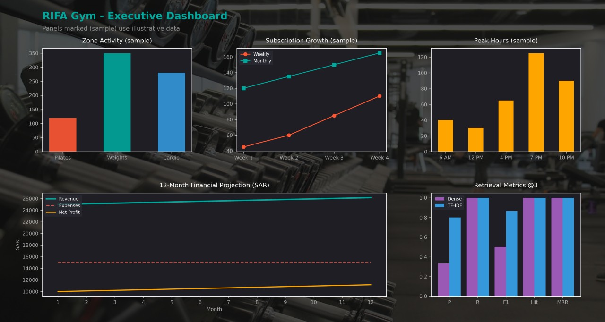

# RIFA Gym

A Python toolkit for running a fitness club with some AI behind it: a searchable knowledge base, hybrid retrieval (TF-IDF and semantic search), document clustering, retrieval metrics, financial projections, and a tool-calling agent for member questions and bookings.

The knowledge base covers three training zones (Pilates, Weightlifting, Cardio), plus nutrition and recovery. Everything runs locally.

---

## Dashboard



The financial projection and retrieval metrics panels are computed. Zone activity, subscription growth, and peak hours use illustrative sample data and are labeled "(sample)".

---

## Features

**Knowledge base**
- Three zones: Pilates (reformer, mat, core), Weightlifting (free squats, bench press, deadlifts, progressive overload), and Cardio (treadmills, bikes, rowers, HIIT)
- Nutrition guidance with macro tracking (1.6 g/kg protein) and a recovery zone (foam rolling, stretching, sauna, massage)

**Preprocessing and tokenization**
- `preprocess()` lowercases, strips punctuation, and collapses whitespace. It is applied to documents and queries before TF-IDF indexing
- `count_tokens()` uses the `tiktoken` GPT-4 encoding to measure query length

**Retrieval**
- Sparse: TF-IDF vectors (English stop words removed) with cosine similarity
- Dense: `all-MiniLM-L6-v2` embeddings from SentenceTransformers, stored in ChromaDB with cosine distance
- Both retrievers return chunk IDs, so they can be scored directly. The agent runs both on every query

**Document clustering**
- K-Means (k=3) over the document embeddings groups knowledge chunks. With only five short documents the grouping is coarse, so treat it as a demonstration of the technique rather than a meaningful topic split

**Retrieval evaluation**
- `evaluate_retrieval()` computes Precision, Recall, F1, Hit Rate, and MRR at a given cutoff k
- `evaluate_search()` averages these over a small labeled query set (5 queries, one relevant chunk each) and runs at k=1 and k=3
- Dense retrieval always returns k results, while TF-IDF returns only chunks with a nonzero match. That makes Precision@3 favor TF-IDF, so compare Precision@1 for a like-for-like view

**Financial projections and ROI**
- Annual revenue estimates for Weekly Pass, Monthly Basic, and Annual VIP plans (SAR)
- `calculate_annual_financials()` builds a 12-month table of revenue, expenses, and net profit, with configurable growth rate and initial investment
- Default scenario (25,000 monthly revenue, 15,000 monthly expenses, 5% annual growth, 150,000 initial investment) gives **84.65%** annual ROI
- The weekly-pass estimate uses a renewal-ratio assumption (`WEEKLY_RENEWAL_RATIO`) that you should tune to real data

**Agent and tools**
- `RifaGymAgent` retrieves context with both retrievers and logs each exchange
- Tool registry (`check_gym_zone_availability`, `list_gym_zones`) with async parallel execution via `asyncio.gather`
- Pydantic booking validation: name length, age 16-90, and zone and tier restricted to known values
- `ConversationMemory` stores history in SQLite and reads back a sliding window of the last 5 messages

---

## Architecture

```text
Member query
     │
     ▼
preprocess() + count_tokens()
     │
     ▼
RifaGymAgent
     ├── Retrieval ── TF-IDF + cosine │ SentenceTransformers + ChromaDB
     ├── Tools ────── availability check, zone listing (async)
     ├── Memory ───── SQLite, sliding window
     └── Finance ──── revenue / expenses / ROI

KnowledgeBase also provides K-Means clusters and
feeds evaluate_search() for retrieval metrics.
     │
     ▼
Console report + dashboard image
```

---

## Sample Output

```text
--- Financial Metrics ---
Total annual revenue : 306,971.39 SAR
Total annual expenses: 180,000.00 SAR
Net annual profit    : 126,971.39 SAR
Annual ROI           : 84.65%

--- Booking Validation ---
Valid booking: {'member_name': 'Sara', 'member_age': 26, ...}
Invalid booking: member_age - Input should be greater than or equal to 16
```

---

## Tech Stack

| Area | Tools |
|---|---|
| Language | Python 3.10+ |
| ML / NLP | scikit-learn, SentenceTransformers, PyTorch, tiktoken |
| Vector store | ChromaDB |
| Data | Pandas, NumPy |
| Validation | Pydantic |
| Visualization | Matplotlib, Pillow |
| Storage | SQLite |

---

## Project Structure

```text
rifa-gym/
├── rifa_gym.py
├── rifa_dashboard.png
├── requirements.txt
└── README.md
```

`rifa_gym.py` is organized into numbered sections:

| Section | Contents |
|---|---|
| 0. Dependencies | Installs missing packages on first run |
| 1. Config | Paths, memory window, evaluation cutoffs, renewal ratio, type aliases |
| 2. Preprocessing | `preprocess()`, `count_tokens()` |
| 3. Plans and financials | `estimate_plan_revenue()`, `calculate_annual_financials()` |
| 4. Knowledge base | `KnowledgeBase`: TF-IDF, embeddings, ChromaDB, K-Means, both search methods |
| 5. Evaluation | `evaluate_retrieval()`, `evaluate_search()`, labeled query set |
| 6. Schemas | `GymBooking` |
| 7. Tools, memory, agent | Tool registry, `run_tool()`, `ConversationMemory`, `RifaGymAgent` |
| 8. Dashboard | `build_dashboard()`, `show_image()` |
| 9. Main | Async entry point and console report |

---

## Getting Started

### 1. Clone

```bash
git clone https://github.com/<your-username>/rifa-gym.git
cd rifa-gym
```

### 2. Install dependencies

The script installs anything missing on first run. To set things up yourself instead:

```bash
python -m venv .venv
source .venv/bin/activate   # Windows: .venv\Scripts\activate

pip install pandas numpy torch tiktoken pydantic scikit-learn \
            sentence-transformers chromadb matplotlib pillow nest-asyncio
```

### 3. Run

```bash
python rifa_gym.py
```

The dashboard is saved to `rifa_dashboard.png`. In Jupyter and Google Colab the script detects the running event loop, applies `nest-asyncio`, and displays the dashboard inline.

### Notes

- The first run downloads the `all-MiniLM-L6-v2` model and the tiktoken encoding files.
- The dashboard background is fetched from Unsplash. Set `USE_BACKGROUND_IMAGE = False` to skip the download.
- ChromaDB is in-memory by default. Use `chromadb.PersistentClient(path="./chroma")` to keep the index between runs.
- Chat history is written to `rifa_gym.db` in the working directory.
- The evaluation set is tiny, so treat the metrics as a sanity check, not a benchmark.

---

## Roadmap

- Stemming or lemmatization in the preprocessing step
- Larger knowledge base and evaluation set
- Real booking backend in place of the in-memory zone table
- LLM-generated responses from retrieved context, with conversation memory passed in
- Replace the sample dashboard panels with real member data

---

## Author

**Abdulrhman**: Computer Science graduate, Taif University
